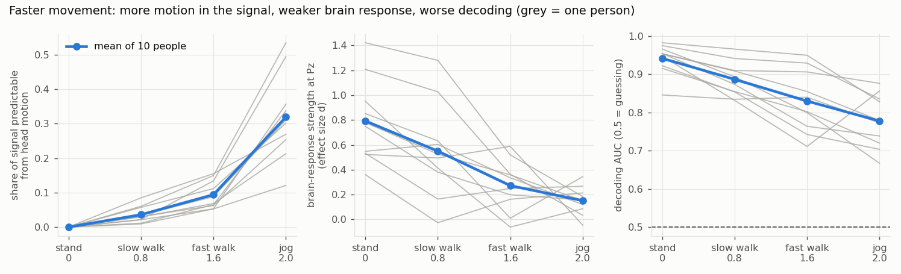
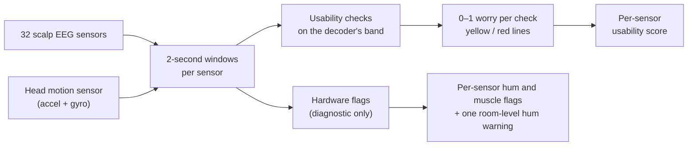

<div align="center">

# Mobile EEG Signal Quality

**A rules-only, per-sensor signal-quality score for EEG recorded while people walk and jog,<br>
plus motion-artifact removal guided by a head-mounted motion sensor.**


[](LICENSE)

[Reports](reports/) · [Signal-quality report](reports/signal_quality_report.md) · [Version 4 fixes](reports/v4_four_fixes_report.md) · [Motion-removal report](reports/area2_motion_removal_report.md) · [Walkthrough notebook](notebooks/01_understand_the_data_and_signal_quality.ipynb)

</div>

---

## Overview

The setup is deliberately limited to what a wearable EEG cap would have: **32 scalp sensors and one head
motion sensor** (accelerometer + gyroscope). Eye sensors are used only as an answer key for blink
detection, never as an input.

Nothing in the score is trained. A decoder appears only as a judge: if the score is meaningful, lower
quality should go with worse decoding.

<p align="center">
  
  <br><sub>Faster movement brings more motion, a weaker brain response and worse decoding.</sub>
</p>

## Highlights

| | |
|---|---|
| **Tracks decoding across speeds** | The score follows decoding accuracy in **10 of 10** people on the tuning set and **4 of 5** on a hold-out that was never opened while tuning |
| **Room hum handled** | In high-hum recordings, hum flags fell from **95% to 0.5%** of sensor-windows; the 2 sensors still flagged are also flagged by pyprep |
| **Scalp-only blink detection** | About **90%** of real blinks found and about **90%** of detections real, while standing and walking |
| **Footstep removal** | While jogging, step-template subtraction plus motion regression improves decoding in **10 of 12** people (p = 0.03) |
| **Honest negatives** | ASR hurt at every speed, IMU-guided ICA had no measurable effect, and within-recording trial ranking is at chance; all reported |

## How the score works



Every sensor is scored every 2 seconds.

**Usability score** (`src/eegqc/usability.py`), computed on the decoder's own analysis band (a setting,
default 0.5–20 Hz):

| Check | Flags a sensor when it is… |
|---|---|
| flat | frozen |
| clipped | stuck at the amplifier's ceiling (kept at every band, since clipping loses all frequencies) |
| amplitude z | much bigger or smaller than the other sensors |
| neighbour correlation | unlike all of its neighbours |
| pop ratio | jumping suddenly (detected on 0.5–45 Hz, where a pop doesn't blur into a blink) |
| motion R² | predictable from the head motion sensor |
| blink | carrying a blink, using a scalp-only blink detector and each person's measured blink spread |
| muscle edge z | buzzier than the others in the top 5 Hz of the band |
| mains hum | humming, counted only if the band contains 50/60 Hz |

Each check maps onto a 0–1 "worry", with yellow and red lines, and the sensor's score combines them.

**Hardware flags** (diagnostic only, they never lower usability): a sensor humming more than the other
sensors (robust z across sensors after average reference, the PREP idea), 30–100 Hz muscle, and **one
room-level hum warning per recording**. Mains frequency is detected automatically.

## Results

The first version was tuned on sub-01..03 and checked on sub-04..10. The current version was tuned on all
ten, then confirmed unchanged on sub-16..20, which were never opened while tuning. Full write-ups are in
[`reports/`](reports/).

| Question | Answer |
|---|---|
| Does the score track decoding across speeds? | ✅ **10 of 10** people on the tuning/checking set (the first, all-checks version managed 5 of 10); **4 of 5** on the never-seen hold-out |
| Does room hum still poison it? | ✅ Fixed. In high-hum recordings, hum flags fell from **95% to 0.5%** of sensor-windows; the 2 sensors still flagged are also flagged by pyprep |
| Does the scalp-only blink detector work? | ✅ ~90% of real blinks found, ~90% of detections real, while standing and walking. Jogging is weaker |
| Can it rank the worse trials within one recording? | ❌ Not on real treadmill trials (chance level, 22 of 40). It **does** order injected artifacts correctly (rank correlation 0.79–0.91), so on steady treadmill walking, trials differ in brain signal rather than artifacts |
| Does removing footsteps help? | ✅ Partly. While jogging, step-template subtraction + motion regression improves decoding in **10 of 12** people (p = 0.03). It costs a little when people barely move, so it should only switch on during movement |
| Do standard methods help? | ❌ ASR hurt at every speed; IMU-guided ICA had no measurable effect |
| Can push-type artifacts be removed? | The accelerometer **detects** them (AUC 0.76 on PhysioNet), but neither simple method removed them |

### Main lessons

1. **Quality has to be defined for a use.** Counting problems the decoder filters out anyway (hum, high
   muscle) made the score useless on people with a noisy room.
2. **Problems that hit every sensor are environment problems**, not sensor problems, and should be reported
   once per recording.
3. **Most of the decoding loss while jogging is not removable footstep artifact.** The best cleaning recovers
   only ~14% of the drop.

## Getting started

### 1. Install

```bash
git clone https://github.com/Aman-Tripathi27/mobile-eeg-signal-quality.git
cd mobile-eeg-signal-quality
python -m venv .venv && source .venv/bin/activate
pip install -r requirements.txt
pip install -r requirements-optional.txt   # only for the ASR / PREP comparison experiments
```

### 2. Get the data

All datasets are public and are **not** included in this repo.

| Dataset | Use | Licence |
|---|---|---|
| Lee et al. 2021, ambulatory EEG ([OSF r7s9b](https://osf.io/r7s9b/), [doi:10.1109/TNSRE.2020.3040264](https://doi.org/10.1109/TNSRE.2020.3040264)) | main dataset: standing, 0.8, 1.6 and 2.0 m/s on a treadmill, ERP task | CC0 |
| Sweeney et al. 2012, motion artifact contaminated EEG ([PhysioNet](https://physionet.org/content/motion-artifact/1.0.0/)) | a real answer key for push-type motion artifacts | ODC-By |

```bash
python tools/download_lee.py sub-01 sub-02 sub-03   # into data/lee2021_mobile_bci/
python tools/check_lee.py                           # sanity-check what was downloaded
```

The loader looks in `data/lee2021_mobile_bci/` by default; set `EEGQC_LEE_ROOT` to use another location.
The Lee loader (`src/eegqc/lee.py`) also fixes three problems found in the raw files: IMU headers that point
to the wrong file name, 13–25 ms of clock drift between the EEG and IMU (aligned on shared event markers),
and undocumented event codes.

### 3. Reproduce the results

Each script regenerates its own numbers and figures. Run them from the project folder.

| Script | What it reproduces | Approx. time |
|---|---|---|
| `scripts/make_quality_report.py` | Every number and figure in the [signal-quality report](reports/signal_quality_report.md) | ~40 min (10 people) |
| `scripts/fix12_usability_and_hum.py` | Usability score tied to the decoder's band; hum compared across sensors | ~10 min |
| `scripts/fix3_ranking.py` | Ranking trials within a recording | ~10 min |
| `scripts/fix4_footsteps_then_blinks.py` | Footstep removal first, then blink detection | ~10 min |
| `scripts/holdout_check.py` | The never-seen hold-out (sub-16..20), with no threshold changed | ~5 min |
| `scripts/area2_physionet.py` | Motion cleaning against the PhysioNet answer key | ~3 min |
| `scripts/area2_treadmill_methods.py` | Motion-cleaning methods compared on the treadmill data (15 people) | ~30–40 min |

```bash
python scripts/holdout_check.py
```

## Project structure

```text
mobile-eeg-signal-quality/
├── src/eegqc/
│   ├── usability.py     # current score: usability layer + hardware flags
│   ├── quality.py       # earlier all-checks version, kept for comparison
│   ├── gait.py          # heel-strike detection and step-template subtraction (after Gwin et al. 2010)
│   ├── validate.py      # decoding judge, eye-sensor blink answer key, event matching
│   └── lee.py           # dataset loader and fixes
├── scripts/             # one script per experiment
├── reports/             # write-ups, figures/ and every result table in results/
├── notebooks/           # a walkthrough of the data and the first version of the score
├── tools/               # dataset download and sanity checks
├── requirements.txt
└── requirements-optional.txt   # meegkit (ASR) and pyprep (PREP), for comparisons only
```

## Limitations

- One public dataset, treadmill walking only. Free movement will produce different artifacts.
- Wet, gel-based sensors. Dry sensors will likely produce more push-type contact artifacts.
- The hold-out is 5 people, and 3 of them have no jogging recording.
- The eye-sensor blink answer key itself gets less reliable while jogging.

## References

- Lee et al. (2021). Ambulatory EEG dataset. [OSF r7s9b](https://osf.io/r7s9b/),
  [doi:10.1109/TNSRE.2020.3040264](https://doi.org/10.1109/TNSRE.2020.3040264)
- Sweeney, K. T., McLoone, S. F., Ward, T. E. (2012). Motion artifact contaminated fNIRS and EEG data.
  [PhysioNet](https://physionet.org/content/motion-artifact/1.0.0/)
- Gwin, J. T., Gramann, K., Makeig, S., Ferris, D. P. (2010). Removal of movement artifact from
  high-density EEG recorded during walking and running. *Journal of Neurophysiology*, 103(6).

## License

Code: [MIT](LICENSE). Datasets keep their own licences.

---

<div align="center">
<sub>Built by <a href="https://github.com/Aman-Tripathi27">Aman Tripathi</a> · <a href="https://amantripathii.netlify.app">Portfolio</a> · <a href="https://www.linkedin.com/in/aman-tripathi27/">LinkedIn</a></sub>
</div>
