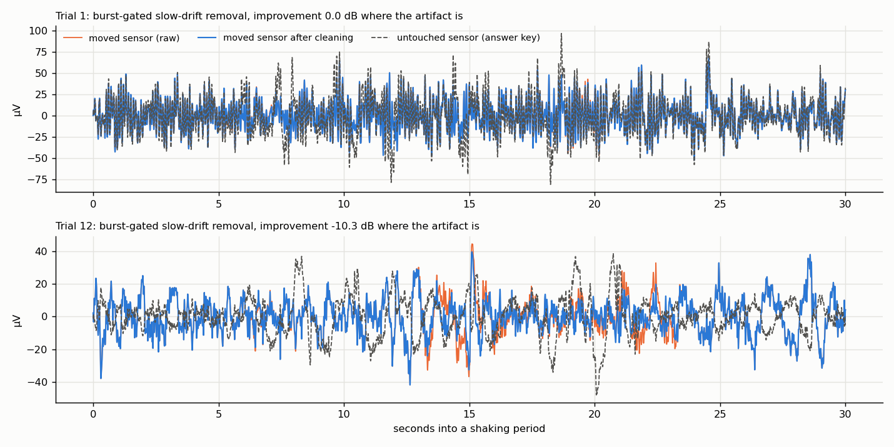

# Area 2: removing motion artifacts with the head motion sensor

**Question:** using only what Sabi's cap has (scalp sensors + a head motion sensor), can we *remove* motion noise,
not just detect it?
**Rules / standard algorithms only:** nothing is trained on labels. The decoder is used only as a judge.
**Reproduce:** `scripts/area2_physionet.py` (~3 min), `scripts/area2_treadmill_methods.py` (~35 min).
Results: `reports/results/area2/`.

---

## Summary

| Test | Result |
|---|---|
| **Treadmill, jogging:** footstep removal + motion regression | ✅ decoding **+0.022**, better in **10 of 12** people (p = 0.03); brain response 0.19 → 0.24 |
| **Treadmill, slow walk / standing:** the same cleaning always on | ❌ small but real **loss** (slow walk −0.013, worse in 12 of 15, p = 0.007) |
| **Gating** (clean only where motion is high) | ✅ safe (no loss when barely moving), but with the pre-set line it cleans too little, and the jogging gain disappears |
| **ASR** (standard burst-removal method) | ❌ hurts at every speed (jogging −0.028) |
| **ICA, removing components the head sensor predicts** | ➖ no effect (removes 1–2 components) |
| **PhysioNet (real answer key), detection** | ✅ accelerometer activity finds the artifact moments (AUC 0.76) |
| **PhysioNet, cleaning** | ❌ no method improves the signal (regression better in 2 of 23 recordings, slow-drift removal in 6 of 23) |

**In one line:** motion artifacts come in different kinds. The rhythmic footstep kind can be partly removed using the
head motion sensor. The slow "sensor pushed" kind can be *detected* but not removed by any simple method we tried.
And cleaning has a cost when there's little to clean, so it must be switched on only when needed.

---

## 1. PhysioNet: a real answer key

**The data** (Sweeney et al. 2012): 23 recordings, each with two forehead sensors side by side. During four 60-s
periods one sensor is pushed and pulled by hand; the other is left alone. Each sensor has its own accelerometer.

**What the artifact looks like:**
- **Short bursts** of motion (a few seconds) inside each 60-s period, not continuous shaking. Labelling the whole
  minute as "shaking" is too coarse. A first version of this test did that and got chance-level results everywhere.
- **Mostly a slow level shift** (most artifact power below 4 Hz). The signal follows *where the sensor was pushed*,
  not how fast it accelerated.

So the test was redone with the **real artifact size**: the moved sensor minus the untouched one (after matching
their scales on the rest periods), measured per 2-s window.

**Detection** (does a measure point to the windows with the biggest real artifact?):

| Measure | AUC (0.5 = guessing) | Rank correlation with artifact size |
|---|---|---|
| **accelerometer activity** (size of >1 Hz acceleration) | **0.76** | 0.32 |
| signal size | 0.76 | 0.65 |
| motion share (regression on acceleration) | 0.51 | 0.05 |

**Cleaning** (scored only in the windows with the biggest real artifact):

| Method | Better than doing nothing | Median change |
|---|---|---|
| regression on the accelerometer | 2 of 23 | −0.36 dB |
| burst-gated slow-drift removal (accelerometer finds the burst; remove <1 Hz drift inside it) | 6 of 23 | −0.02 dB |

**What this means:**
- The accelerometer is a good **detector** of push-type artifacts. That's useful for quality scoring: mark those
  moments unusable.
- Neither simple method **removes** them. The published method on this dataset (EEMD-CCA, Sweeney et al. 2013) uses
  a more complex signal decomposition; I didn't implement it.
- I stopped after two methods on purpose, rather than tweaking until one "works" on 23 recordings.
- **Caveat:** the "untouched" sensor isn't a perfect copy even at rest (in some recordings their similarity at rest is
  low, e.g. 0.03–0.29). So the answer key is imperfect for those recordings.

---

## 2. Treadmill data: five methods compared (15 people)

| Method | What it does |
|---|---|
| raw | median reference only |
| steps+R always | footstep template subtraction (previous 30 steps) + regression on head motion, every sensor |
| steps+R gated | the same, only on sensors whose motion share > 0.3 (the motion check's yellow line) |
| ASR | Artifact Subspace Reconstruction (meegkit, cutoff 20), calibrated on the first 2 min of the person's standing recording |
| ICA (head-IMU) | 20 independent components; remove those whose time course the head motion sensor predicts (share > 0.3) |

**Decoding AUC (mean of 15 people; 12 for jogging, since 3 hold-out people have no jogging recording):**

| Speed | raw | steps+R always | steps+R gated | ASR | ICA (head-IMU) |
|---|---|---|---|---|---|
| standing | 0.938 | 0.934 | **0.938** | 0.935 | 0.938 |
| slow walk | 0.892 | 0.879 ❌ | **0.891** | 0.882 ❌ | 0.892 |
| fast walk | 0.844 | 0.836 | 0.841 | 0.833 | 0.844 |
| **jog** | 0.784 | **0.806 ✅** | 0.787 | 0.756 | 0.783 |

**Brain-response strength at Pz while jogging:**

| raw | steps+R always | steps+R gated | ASR | ICA |
|---|---|---|---|---|
| 0.19 | **0.24** | 0.23 | 0.20 | 0.23 |

All cleaning methods make the brain response itself a bit clearer while jogging. Only "always" turns that into
better decoding.

**Paired with raw, same person:**
- **Jogging, steps+R always:** better in **10 of 12** (p = 0.03).
- **Slow walk, steps+R always:** worse in 12 of 15 (p = 0.007).
- **Slow walk, ASR:** worse in 11 of 15 (p = 0.04).

**What each method teaches:**
- **Footstep removal works where footsteps dominate (jogging) and costs a little elsewhere.** The template is an
  average of 30 steps, so it carries a little leftover brain signal and noise that gets subtracted too.
- **The per-sensor gate is safe but too strict.** It cleans a median of 0 / 1 / 2 / 9.5 sensors at the four speeds.
  The decoder uses all 32 sensors, and sensors under the line still carry motion.
- **A recording-level gate with the same 0.3 line switches on only once:** the typical sensor's motion share over a
  whole jogging recording is just 0.14. The 0.3 line was set for single 2-s windows, not whole recordings.
  Choosing a better line means **tuning on these 15 people, then confirming on new people.** The 9 remaining
  treadmill people (area 3 download) are exactly that test.
- **ASR hurts.** It treats high-variance moments as artifacts and rebuilds them from the calibration data; during
  movement that also removes real signal. A gentler cutoff might hurt less, but that's tuning I haven't done.
- **IMU-guided ICA does nothing measurable.** Footstep noise is spread across many components rather than isolated
  in one or two that the head sensor predicts.

---

## 3. What this means for Sabi

1. **Use the head motion sensor first as a detector**, to mark motion moments unusable. That works for both
   artifact types tested.
2. **Remove only the rhythmic, step-locked kind**, and **only when the person is clearly moving.** Otherwise
   cleaning costs more than it gains.
3. **Most of the decoding loss while jogging is not removable footstep artifact.** Even the best cleaning recovers
   only ~14% of the drop (0.938 → 0.784 → 0.806). The rest is likely muscle activity and a genuinely weaker brain
   response while running.
4. **Dry sensors probably make push-type artifacts much more common.** Those need either better hardware contact or
   more advanced decomposition methods.

## 4. Next steps for area 2
- Choose a recording-level gate on these 15 people; **confirm it on the 9 new people** (area 3 download).
- Optionally implement EEMD-CCA (the published PhysioNet method) as a stronger push-artifact cleaner.
