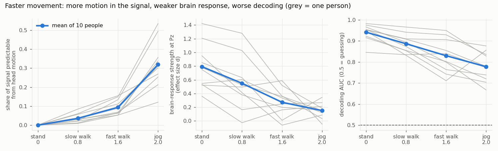
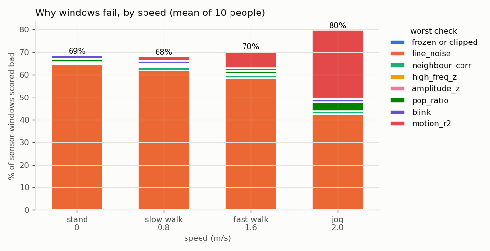
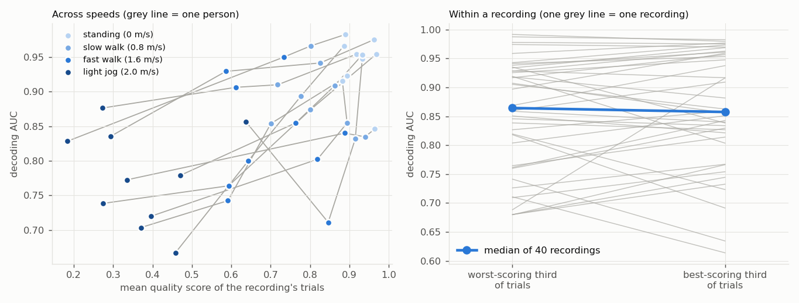
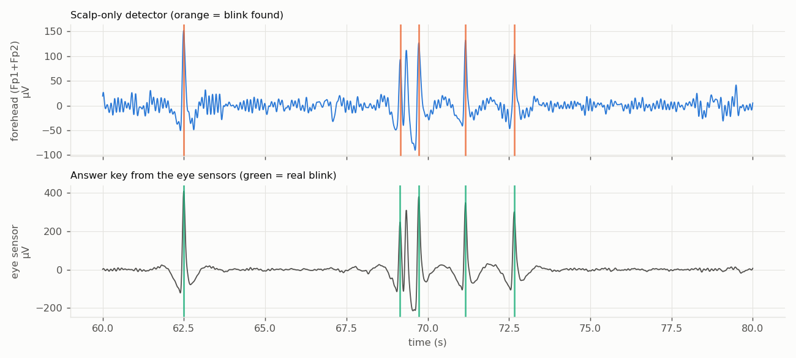
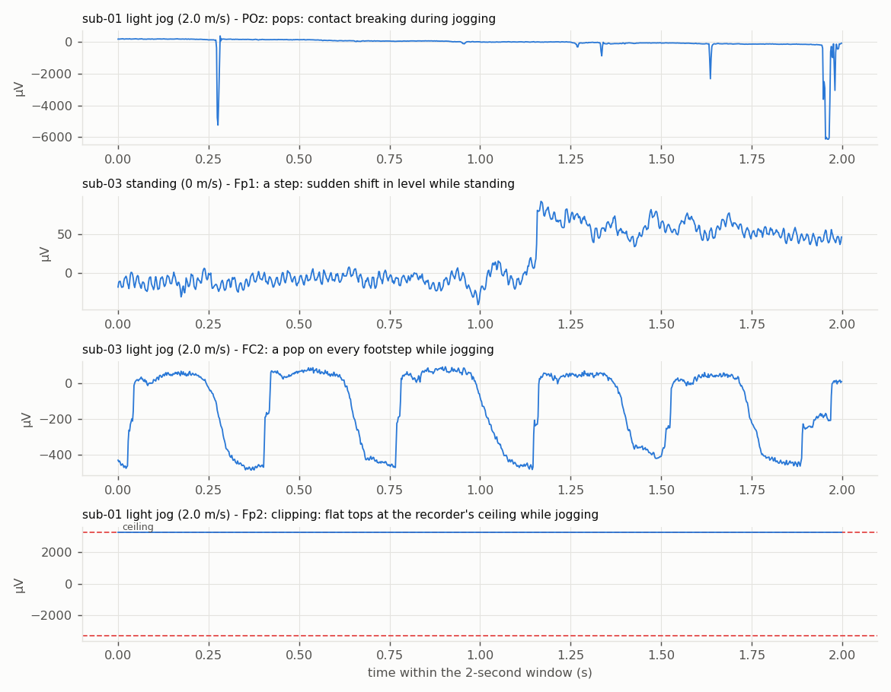
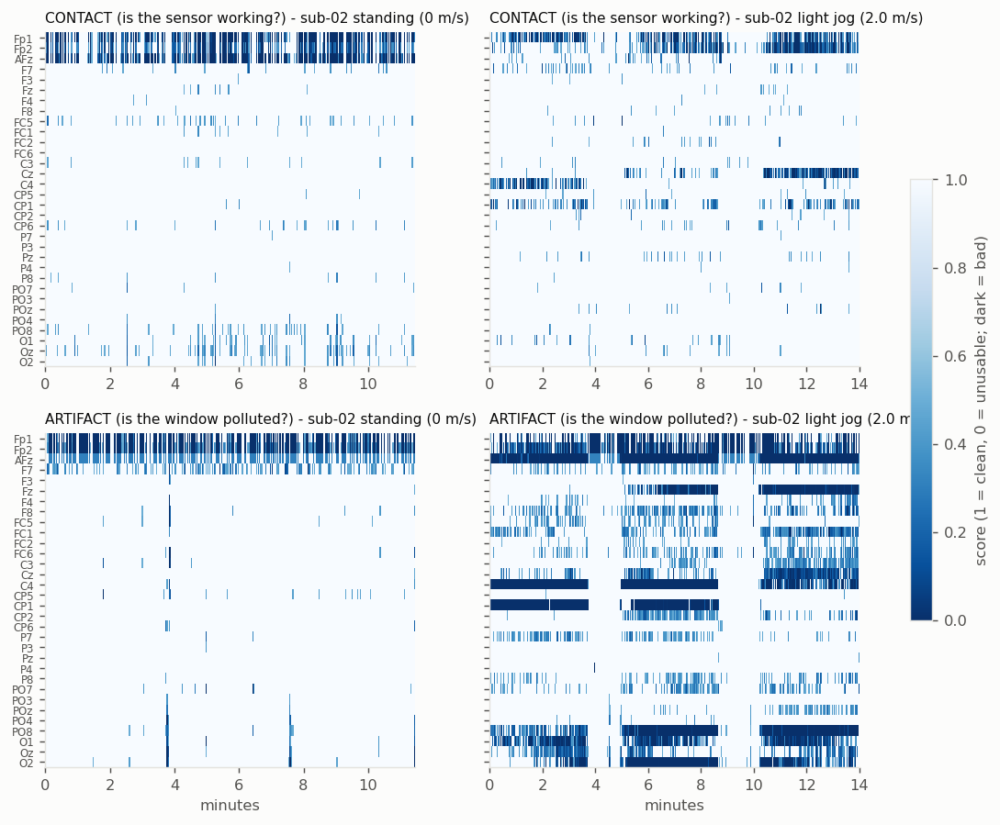

# Signal-quality scoring for mobile EEG — report (version 3: 10 people, Sabi-like setup)

**Data:** Lee et al. 2021 mobile EEG dataset, **10 people** × 4 treadmill speeds (standing, 0.8, 1.6, 2.0 m/s) = 40
recordings of the "spotted it!" letter task (300 flashes each).
**Scope = what Sabi's cap has:** 32 scalp sensors + the motion sensor on the head (accelerometer + gyroscope).
Ear sensors and ankle motion sensors are ignored. Eye sensors are used **only as an answer key** to grade blink detection.
**Code:** `src/eegqc/quality.py` (score), `src/eegqc/validate.py` (tests), `scripts/make_quality_report.py`
(reproduces everything, ~40 min).

**How to read "does it hold up?":** I chose thresholds while looking at **sub-01..03** ("tuning" people).
**sub-04..10** ("new" people) were never looked at, so they're a fair test.

---

## 1. Summary

| Question | Answer |
|---|---|
| Does motion pollution rise with speed, for new people too? | ✅ **Yes.** Polluted windows: 10% standing → 59% jogging (all 10). Same pattern in tuning and new people |
| Does the scalp-only blink detector work on new people? | ✅ **Yes, when not jogging:** finds ~90% of real blinks, ~95% of detections real. ❌ **While jogging it breaks** (only 45% of detections real in new people) |
| Does lower quality go with worse brain-signal decoding, across speeds? | ✅ **Yes, in all 10 people**, but only with the use-specific score (see 5.1). The all-checks score fails on new people |
| Can the score pick out the worse *trials* within one recording? | ❌ **Still no** (22 of 40 recordings; no better than chance) |
| Biggest surprise | **6 of the 7 new people have mains hum 3–7× bigger than their brain signal.** The hum check flags ~87% of their windows, even standing |

---

## 2. What changed since version 2

1. **Scope narrowed to Sabi's setup:** scalp sensors + head motion sensor only. All ear-sensor analysis removed.
2. **New check: blink, from scalp sensors only** (Sabi has no eye sensors). How it works, in plain words:
   - **Fingerprint:** a big swing on both forehead sensors (Fp1, Fp2), more than **4× their typical swing**, in the
     same direction, and less than 30% as big at the back of the head (Pz, POz, Oz).
   - **One event per half second:** filtering turns each blink into an up- and a down-swing, which is one blink, not two.
   - **Blink reach:** from the person's average blink, how big it is on each sensor relative to the forehead (e.g.
     sub-02: Fp1/Fp2 100%, AFz 41%, F7 29%, then nothing). In a window with a blink, a sensor gets a blink worry only
     if the blink actually reaches it (yellow 0.3, red 0.6).
3. **A sturdier answer key for blinks.** MNE's standard blink finder set its threshold from the single biggest swing
   in a recording, so one huge artifact hid almost every blink. It reported 0–2 blinks/minute for 3 people, which is
   impossible. The answer key now uses "5× the typical swing" on the eye sensors, giving a realistic 14–30
   blinks/minute for everyone while standing.
4. **10 people instead of 3**, with tuning and new people reported separately.

The 9 checks now:

| Group | Check | Bad when | Yellow / red |
|---|---|---|---|
| contact | flat | frozen | 30% / 60% of readings repeated |
| contact | clipped | stuck at ceiling (flat tops) | 0.3% / 2% |
| contact | line_noise | mains hum vs brain signal | 0.10 / 0.30 |
| contact | neighbour_corr | unlike all 4 neighbours | 0.4 / 0.2 (lower = worse) |
| artifact | high_freq_z | buzzier than other sensors (muscle) | z 3 / 6 |
| artifact | amplitude_z | much bigger/smaller than others | z 3 / 6 |
| artifact | pop_ratio | sudden jump | 15 / 30 |
| artifact | motion_r2 | predictable from head motion | 0.3 / 0.6 |
| artifact | **blink** (new) | blink visible on this sensor | 0.3 / 0.6 |

---

## 3. Does it hold up on new people? (by speed, mean per group)

| Measure | Group | Stand | Slow | Fast | Jog | Holds up? |
|---|---|---|---|---|---|---|
| **% windows polluted (artifact)** | tuning | 7 | 11 | 23 | 50 | |
| | new | 11 | 15 | 29 | 62 | ✅ same pattern |
| **Share of signal from head motion** | tuning | 0.00 | 0.04 | 0.09 | 0.25 | |
| | new | 0.00 | 0.03 | 0.10 | 0.35 | ✅ |
| **% windows sensor not working (contact)** | tuning | 16 | 13 | 8 | 6 | |
| | new | **87** | **87** | **85** | **69** | ❌ **very different** (mains hum, section 4) |
| **Brain-response strength at Pz (d)** | tuning | 0.61 | 0.18 | 0.12 | 0.19 | |
| | new | 0.87 | 0.71 | 0.34 | 0.14 | ✅ weakens with speed |
| **Decoding AUC** | tuning | 0.92 | 0.87 | 0.83 | 0.82 | |
| | new | 0.95 | 0.89 | 0.83 | 0.76 | ✅ worsens with speed |

**Movement hurts everyone:** in all 10 people the brain response weakens and decoding drops as speed rises (mean AUC
0.94 standing → 0.78 jogging). Motion's share of the signal rises from 0 to ~0.3. **The artifact half of the score
generalises to new people. The contact half does not.**

---

## 4. The surprise: mains hum in the new people

| Person | 60 Hz hum vs brain signal (sensors on median reference) |
|---|---|
| sub-02 (tuning) | hum 1.8 µV, brain 13.3 µV → hum is **0.1×** the brain signal |
| sub-05 (new) | hum 24.5 µV, brain 7.1 µV → **3.5×** |
| sub-08 (new) | hum 48.8 µV, brain 12.8 µV → **3.8×** (115 µV vs 19 µV as recorded) |

In sub-05..10 the building's electrical hum is **several times bigger than the brain signal on almost every sensor**.
sub-04 looks like the tuning people. The dataset doesn't say why. A different room, cabling or grounding on those
recording days is plausible, but that's a guess.

**What this teaches:**
- **The check is right, the interpretation isn't.** It correctly says "this signal is full of hum". But it calls that a
  *sensor contact* problem, when here it's the **whole room**: every sensor has it.
- **Hum is harmless for this use.** The brain-response analysis filters to 0.5–20 Hz, which removes 60 Hz completely,
  and the new people's brain response is actually *stronger* than the tuning people's (0.87 vs 0.61 standing).
- **It's the version-2 lesson again ("quality depends on the use"), now shown on new people.**
- **Fix:**
  - (a) judge hum **relative to the other sensors**, like the muscle check, so only a sensor *worse than the room*
    is flagged
  - (b) report room-wide hum **once per recording**, as an environment warning

  This matters even more for dry sensors.

---

## 5. Validation against the brain's "spotted it!" response

Two versions of the score:
- **All checks**
- **Use-specific:** only the checks that matter after the 0.5–20 Hz filter, i.e. leaving out mains hum and muscle buzz

### 5.1 Across speeds: does lower quality go with worse decoding?

| Group | All checks | Use-specific |
|---|---|---|
| tuning (3 people) | positive in 3 of 3 | positive in 3 of 3 |
| new (7 people) | positive in **2 of 7** (median correlation −0.4) | positive in **7 of 7** (median correlation 1.0) |
| **all 10** | 5 of 10 | **10 of 10** |

**This is the strongest result so far.**
- **Use-specific score:** in **every one of the 10 people**, the speed with lower quality had worse decoding.
  If quality meant nothing, all 10 lining up would happen by chance about 2 times in 1000 (p ≈ 0.002).
- **All-checks score:** fails on new people, because their hum-driven "bad" share is ~87% at every speed and so can't
  track anything.

**Caveat:** this is only 4 speeds per person, and speed drives both quality and decoding. So it shows the score tracks
*conditions* that hurt decoding, not that it understands *why*.

### 5.2 Within a recording: are the best-scoring trials easier to decode?

| | All checks | Use-specific |
|---|---|---|
| Best third beats worst third | 22 of 40 recordings (p = 0.73) | 22 of 40 (p = 0.32) |
| Brain response clearer in "good" than "bad" trials (per sensor) | 23 of 55, i.e. **slightly the wrong way** (p = 0.02) | 49 of 87 (p = 0.45) |

**Still not shown, now with 40 recordings instead of 12.** With the all-checks score, trials called "bad" even had a
*slightly clearer* brain response. I don't have a confirmed explanation for that yet, so I'm reporting it, not
explaining it away.

Why moment-to-moment ranking is hard here (from version 2, still true):
1. On a treadmill the movement is **steady** within a recording.
2. Most windows score exactly 0 or 1, so small differences between trials are lost.
3. 60 targets per recording make each comparison noisy.

---

## 6. Blink detection from the scalp only (graded by the eye sensors)

| Group | Measure | Stand | Slow | Fast | Jog |
|---|---|---|---|---|---|
| tuning | % of real blinks found | 83 | 93 | 95 | 85 |
| | % of detections that are real | 94 | 91 | 94 | 85 |
| **new** | % of real blinks found | **91** | **97** | **92** | **78** |
| | % of detections that are real | **95** | **90** | **90** | **45** |

**Blink detection holds up on new people while standing and walking: ~90–97% found, ~90–95% real.**
While jogging, footstep swings on the forehead get as big as blinks, so **more than half the "blinks" are footsteps**
in the new people. The answer key itself also gets shakier while jogging: its blink rate drops to ~11 per minute,
because footsteps raise the "typical swing" the key compares against.

---

## 7. Other results

**Most often broken sensors (all 40 recordings):** **AFz 34×, Fp1 34×, Fp2 33×**: the forehead row, in every group.
They're also the most polluted (~70% of windows), from hum, blinks and motion combined.

**Agreement with the authors' "bad" labels:**

| | Both | Only ours | Only authors' |
|---|---|---|---|
| tuning | 7 | 21 | 17 |
| new | 60 | 668 | 3 |

In the new people we flag almost everything (the hum), while the authors flagged very little. They evidently didn't
treat hum as "bad", which fits the use-specific view.

**What the checks catch (unchanged):**
- pops of thousands of µV
- a sensor jumping on every footstep
- sudden level steps
- clipping (Fp2 while jogging)
- the score going clean when someone **stopped for a break**

---

## 8. What works, what doesn't, and the bottleneck

**Works on new people:** motion check · pop check · blink check (when not jogging) · the use-specific score tracking
decoding across speeds (10 of 10).

**Doesn't work:**
- the hum check's interpretation (room hum called "sensor broken")
- ranking individual trials within a recording
- blinks while jogging

**The bottleneck (unchanged, now confirmed on new people):** *the score must be defined for a use.* Problems that the
downstream processing removes (hum, high buzz) must not count. Where problems hit everyone at once (hum in a noisy
room, the whole cap shaking), the score must say "environment" or "motion", not "this sensor is broken".

---

## 9. Next steps
1. **Hum relative to the other sensors**, plus one room-hum warning per recording.
2. **Make the use-specific score the default** for brain-response work, and keep it a sliding number rather than
   mostly 0/1.
3. **Blinks while moving:** use the head motion sensor to reject footstep-locked swings before calling something a blink.
4. **Then motion removal (area 2):** now that motion is measured per sensor, remove it and check the brain response
   recovers. That's the strongest proof the motion check is right.

---

## 10. Files

| File | What it is |
|---|---|
| `src/eegqc/quality.py` | 9 checks, worry formula, contact/artifact scores, blink detector |
| `src/eegqc/validate.py` | brain-response tests, eye-sensor answer key, event matching |
| `scripts/make_quality_report.py` | reproduces every number and figure here |
| `tools/download_lee.py`, `tools/check_lee.py` | download participants; sanity-check them (all 10 passed) |
| `reports/results/summary_by_group_and_speed.csv` | the "does it hold up" table |
| `reports/results/validation_stats.csv`, `blinks.csv`, `sensors_ranked.csv`, … | every other number |
| `notebooks/01_...ipynb` | learning notebook, now scalp + head-motion only, with the scalp-only blink section |
