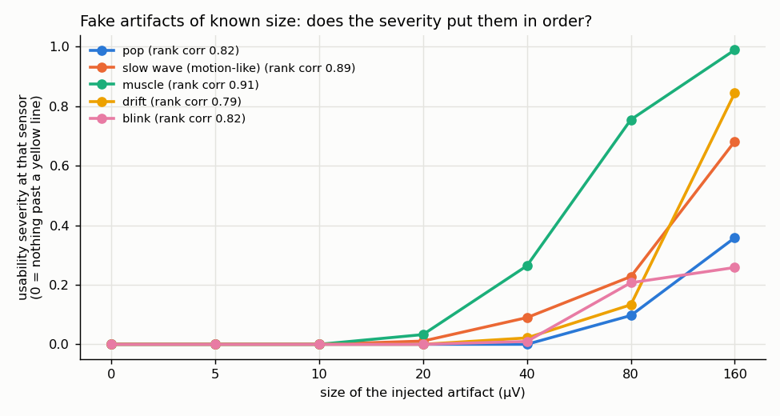
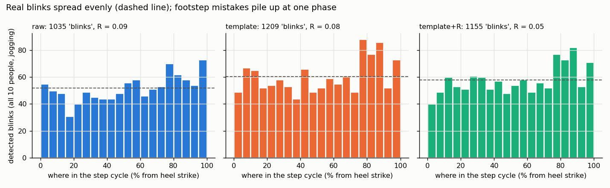
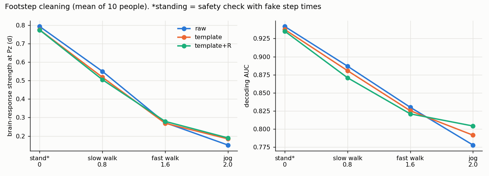

# Signal quality, version 4: the four fixes

**Scope:** 10 people × 4 treadmill speeds (40 recordings), 32 scalp sensors + the head motion sensor (Sabi's setup).
The eye sensors are used only as an answer key for blinks.
**Rules only:** the quality score has fixed thresholds and the worry formula; nothing is trained. A decoder appears
only as a **judge** (to check whether the score tracks decoding), never inside the score.
**Reproduce:** `scripts/fix12_usability_and_hum.py`, `scripts/fix3_ranking.py`,
`scripts/fix4_footsteps_then_blinks.py` (each ~5–15 min). Numbers are in `reports/results/v4/`.

**Caveat:** all 10 people have now been looked at, so every threshold below was chosen on them. The plan's last step
(confirming on people never opened) needs a download (section 6).

---

## Summary

| Fix | What changed | Result | Verdict |
|---|---|---|---|
| **1. Score matches the decoder** | usability score computed on the decoder's 0.5–20 Hz band; hardware problems become diagnostic flags | tracks decoding across speeds in **10 of 10** people (old score: 5 of 10) | ✅ |
| **2. Hum compared across sensors** | hum judged against the other sensors + one room warning per recording + automatic 50/60 Hz detection | hum flags in high-hum recordings: **95% → 0.5%** of sensor-windows; the 2 sensors flagged are also flagged by pyprep | ✅ |
| **3. Ranking trials** | severity (no ties), each trial's exact span, continuous targets, fake-artifact test | **orders fake artifacts correctly** (rank correlation 0.79–0.91), but **nothing ranks real treadmill trials**, not even peak-to-peak size | ✅ score / ❌ data |
| **4. Remove footsteps, then blinks** | step-template subtraction from the head sensor (Gwin 2010) + motion regression; blink detector checks duration | jogging: unusable 61% → 13%, blink rate 55% → 87% of standing, decoding **+0.026 in 9 of 10**; small cost when barely moving | ✅ partly |

---

## Fix 1: the usability score matches what the decoder sees

**What changed** (new file `src/eegqc/usability.py`; the old `quality.py` is kept for comparison):

- **Usability layer (the default).** Every check runs on the analysis band, which is now a **setting**
  (default 0.5–20 Hz):
  - frozen
  - clipped (kept, because clipping loses the signal at every frequency)
  - size vs other sensors
  - unlike its neighbours
  - sudden jumps
  - share explained by head motion
  - blink
  - muscle leaking into the **top 5 Hz of the band** (15–20 Hz)
  - mains hum, but **only if the band contains 50/60 Hz** (so a decoder using higher frequencies automatically
    starts counting it)
- **Hardware flags (diagnostic only, never lower usability):** hum worse than the other sensors, 30–100 Hz muscle,
  frozen, clipped, and the room hum warning.

**Two changes from the plan, found while testing:**
- **Pops are detected on 0.5–45 Hz, not 0.5–20 Hz.** A 20 Hz filter blurs a pop until it looks like a blink: in
  some standing recordings 55–100% of "pops" were blinks. On 0.5–45 Hz (still below mains hum), false pops while
  standing dropped 3–10×, and all known real pops were still caught. A pop still counts against usability, because
  it damages the in-band signal too.
- **The room-warning line is "hum as strong as the brain signal"** (power ratio 1.0). The first guess (0.10) fired
  even on low-hum recordings.

**Does the score track decoding across the 4 speeds, per person?** (Spearman correlation, 1 = perfect)

| | sub-01 | 02 | 03 | 04 | 05 | 06 | 07 | 08 | 09 | 10 | Positive |
|---|---|---|---|---|---|---|---|---|---|---|---|
| Old (all checks, v3) | 0.8 | 0.4 | 0.8 | 0.4 | −1.0 | −0.4 | −0.8 | −0.4 | −0.8 | 0.4 | 5 of 10 |
| **New usability** | 1.0 | 0.4 | 0.8 | 1.0 | 1.0 | 1.0 | 1.0 | 1.0 | 1.0 | 1.0 | **10 of 10** |

---

## Fix 2: hum compared across sensors, plus a room warning

**How it works:**
1. Re-reference to the **average** of all sensors, so hum shared by every sensor cancels.
2. Compute each sensor's hum ratio: power at 50/60 ±1 Hz ÷ power at 1–40 Hz, then take the log.
3. Robust z across sensors. Flag a sensor at z > 3.5 (the same idea as the PREP pipeline's high-frequency noise check).
4. **Room warning**, measured *before* re-referencing: one per recording, if the typical sensor's hum is as strong
   as its brain signal.
5. **Mains frequency auto-detected** (50 vs 60 Hz, whichever peak stands out). All 40 recordings: 60 Hz (Korea).

**Results:**

| | Old (fixed threshold) | New (vs other sensors) |
|---|---|---|
| Recordings with the room warning | – | **20 of 40** |
| Hum-flagged sensor-windows in those 20 recordings | **95%** | **0.5%** |
| Sensors flagged for hum in most of a recording | nearly all | **2** (CP2, sub-06, two sessions) |
| …also flagged by pyprep | – | **2 of 2** |
| …also failing other usability checks | – | 1 of 2 |

**New finding:** the hum belongs to the **recording session**, not the person. sub-05 to sub-10 have huge hum while
standing (room value 18–104) but little while jogging (0.07–6). So a per-recording room warning is the right level.

**pyprep flags many more sensors** than our hum check (mostly forehead sensors). It also looks at size, correlation
and high-frequency noise, so those flags are for other reasons, not hum.

---

## Fix 3: can we rank trials within a recording?

**What was tested, one change at a time:**

| Score (larger = worse trial) | vs decoder's probability for the right answer | vs distance from the person's average response |
|---|---|---|
| pass/fail, 2-s grid (old way) | 22 of 40 right direction | 22 of 40 |
| pass/fail, exact trial span | 17 of 40 | 21 of 40 |
| severity, 2-s grid | 17 of 40 | 22 of 40 |
| **severity, exact trial span** (new way) | 18 of 40 | 23 of 40 |
| motion share only | 22 of 40 | 12 of 40 (*wrong* direction, p = 0.02) |
| **baseline: peak-to-peak size** | **25 of 40 (p = 0.15)** | 40 of 40 (but circular: big trials are far from the average by definition) |

(20 of 40 = chance. None of the score variants beats chance against either target.)

**What this means:**
- **Ties were not the problem.** Even the pass/fail score had ~296 distinct values per recording, because it's
  averaged over 32 sensors.
- **Nothing ranks real trials by decodability, not even raw size.** On a treadmill at constant speed, trials differ
  mostly in **brain variability, not artifacts**. So there's nothing artifact-shaped for a quality score to rank.
  This is a finding about the data, not a failure of the score.
- **The score *can* rank when artifacts differ.** Fake artifacts of known size were added to the cleanest standing
  trials:

| Fake artifact | Severity starts rising at | Rank correlation (size vs severity) |
|---|---|---|
| muscle (15–45 Hz noise) | ~20 µV | 0.91 |
| motion-like slow wave (2.75 Hz) | ~20–40 µV | 0.89 |
| pop (10 ms spike) | ~80 µV | 0.82 |
| blink (on Fp1/Fp2) | ~80 µV | 0.82 |
| drift (1-s slow hump) | ~40–80 µV | 0.79 |

**Unexplained:** trials with *more* head motion were slightly *closer* to the person's average response
(12 of 40, p = 0.02). I don't have a confirmed reason, so it's reported as is.

---

## Fix 4: remove footsteps first, then detect blinks

**How it works** (`src/eegqc/gait.py`, head motion sensor only):

1. **Heel strikes** = sharp peaks in the head's vertical acceleration. Both peak directions are tried, and we keep
   the one whose steps are most regular *and* match the step rate in the spectrum.
   - **Fixed along the way:** one person's head bounce was strongest at twice the step rate, so the rule now prefers
     the half rate when it's strong.
   - **Result:** step rates are consistent for all 10 people (~1.5/s slow walk, ~2.05/s fast walk, ~2.78/s jog;
     intervals regular within 2–4%).
2. **Step phase** 0–100% between heel strikes.
   - Note: one head sensor can't tell left foot from right, so the cycle is one **step**, not a two-step stride.
3. **Template subtraction:** for each sensor, the average of the **previous 30 steps** (phase-aligned) is subtracted
   from the current step.
   - It uses past steps only, so it could run live.
   - Stumbles and pauses are left untouched.
4. **Optional:** regress out what's left using the head motion signals (fitted on every other 2-s block, applied to
   the rest).
5. **Blink detector** also required a **duration of 100–400 ms**.
   ⚠️ **Removed afterwards.** On the filtered signal, 39–49% of real blinks measure under 100 ms, and real blinks
   and footstep mistakes have the same duration while jogging (101 vs 99 ms). So the rule cut blinks found while
   standing from ~90% to ~60% and removed no errors. The blink numbers in the table below were measured *with* the
   rule; see the hold-out check for the corrected detector.

**Results** (medians over 10 people):

| | Raw | Footsteps removed | + leftover motion removed |
|---|---|---|---|
| **Jogging:** share of signal from head motion | 0.33 | 0.08 | 0.00 |
| **Jogging:** unusable windows | 61% | 27% | **13%** |
| **Jogging:** blink rate vs standing | 55% | **87%** | 76% |
| **Jogging:** blinks bunched at one step phase (R; 0 = even) | 0.29 | **0.11** | 0.12 |
| **Jogging:** decoding AUC | 0.776 | 0.782 | **0.797** (better in 9 of 10, p = 0.01) |
| **Safety, standing with fake steps:** decoding AUC | 0.954 | 0.951 | 0.945 (worse in 8 of 10, p = 0.05) |
| **Slow walk:** decoding AUC | 0.884 | 0.859 | 0.853 (worse in 9 of 10, p = 0.01) |

**Honest reading:**
- **While jogging, cleaning clearly helps quality and blink detection, and slightly helps decoding.** But the gain
  is only ~12% of the decoding drop from standing (0.954 → 0.776; cleaned 0.797).
- **When there's little movement, cleaning costs a little** (standing, slow walk). Subtracting a template also
  subtracts a bit of noise and brain signal. **Practical rule:** clean only when the measured motion share is high
  (e.g. above the motion check's yellow line).
- **The step-phase histogram isn't fully flat.** Pooled over everyone, a small pile-up remains at 75–95% of the
  step cycle, so some footstep-locked detections survive.
- **The answer key itself is weak while jogging.** Even after cleaning the eye sensors, it finds only ~19
  blinks/minute, and the detector matches 40% of them. So blink accuracy while jogging is uncertain in both
  directions.

---

## 5. Where this leaves us

1. **Signal quality is now tied to its use.** It tracks decoding in every person, and hum no longer poisons it.
2. **Hardware problems are reported separately** (one room warning, or a specific sensor), which is what someone
   fitting a cap needs.
3. **The score orders artifacts by size,** but real treadmill trials differ in brain signal, not artifacts. That's
   a limit of steady treadmill data. Free movement (Sabi's users) should vary far more.
4. **Footstep removal is the first real step into area 2.** It works while jogging, needs a "clean only when
   moving" rule, and recovers only part of the lost decoding. Most of the drop isn't footstep artifact, so the next
   suspects are muscle tension and a genuinely weaker brain response while running.

## 6. Still to do: confirm on people never opened

Every threshold above was chosen while looking at sub-01..10. The plan's rule: confirm on people never opened.

| Option | People | Download |
|---|---|---|
| Suggested hold-out | sub-16 … sub-20 | **1.78 GB** (1.41 GB without the simplified copy); 39 GB free |

They avoid the participants with known defects (sub-11..15, sub-21).
